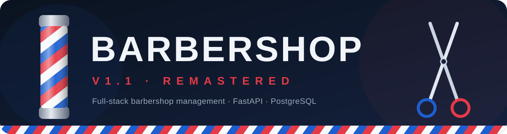
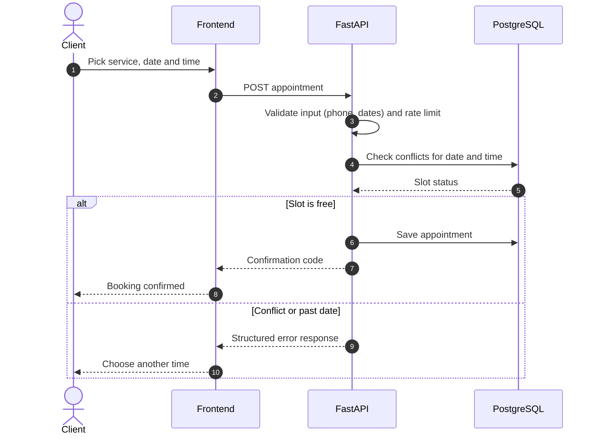
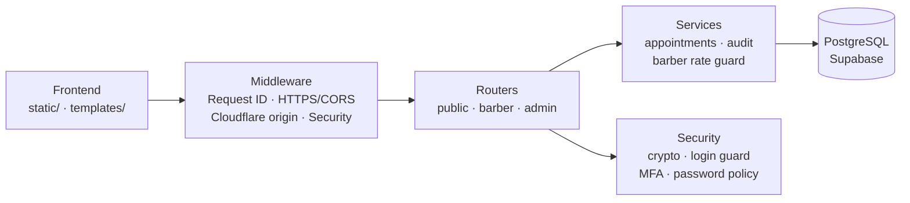

<div align="center">



<br/>


<br/><br/>

**A production-ready full-stack barbershop management system.**<br/>
Built with clean architecture, a real database, and modern deployment.

<br/>

<a href="#live-application"><b>Live</b></a> &nbsp;·&nbsp;
<a href="#overview"><b>Overview</b></a> &nbsp;·&nbsp;
<a href="#features"><b>Features</b></a> &nbsp;·&nbsp;
<a href="#architecture"><b>Architecture</b></a> &nbsp;·&nbsp;
<a href="#security"><b>Security</b></a> &nbsp;·&nbsp;
<a href="#tech-stack"><b>Stack</b></a> &nbsp;·&nbsp;
<a href="#project-structure"><b>Structure</b></a> &nbsp;·&nbsp;
<a href="#evolution"><b>Evolution</b></a> &nbsp;·&nbsp;
<a href="#running-locally"><b>Run</b></a> &nbsp;·&nbsp;
<a href="#roadmap"><b>Roadmap</b></a>

</div>


## Live Application

<div align="center">

| 🔗 Frontend | ⚙️ API |
|:---:|:---:|
| [**Access App**](#) | [**View Docs**](#) |

</div>


## Overview

> [!IMPORTANT]
> This project is a **complete remaster** of a previous barbershop system, rebuilt from scratch.
> Unlike the previous version, it runs on **real cloud infrastructure**, replacing local storage with a robust and persistent database.

<div align="center">

| 📈 Scalability | 🧩 Maintainability | 🏛️ Real-world architecture | 🚀 Production deployment |
|:---:|:---:|:---:|:---:|
| Persistent cloud database | Modular FastAPI codebase | Routers · Services · Security | Render + Vercel |

</div>


## Features

_The service menu:_

| | Service | What you get |
|:---:|---|---|
| 👤 | **Authentication & Roles** | Admin, Barber, and Client access control · Protected routes via token validation |
| 📅 | **Scheduling System** | Smart appointment creation · Conflict prevention (date & time validation) · Past-date blocking |
| 🔄 | **Appointment Management** | Rescheduling system · Cancellation flow · Unique confirmation code tracking |
| 🌍 | **Internationalization** | Full support for **English** and **Portuguese (BR)** |
| 🎨 | **User Experience** | Light / Dark mode · Clean and modern UI · Responsive layout |


## Architecture

**How a booking travels through the system:**



**How the layers connect:**



**Layers:**

| Layer | Location | Responsibility |
|---|---|---|
| Routers | `app/routers/` | Modular endpoints: `public`, `barber`, `admin` |
| Services | `app/services/` | Business logic: appointments, audit, barber rate guard |
| Security | `app/security/` | Crypto, login guard, MFA, password policy |
| Middleware | `app/middleware/` | Request ID, HTTPS / CORS, Cloudflare origin, security layer |
| Data | `app/models.py` · `supabase_schema.sql` | Models and PostgreSQL schema |
| Config | `app/config.py` · `.env.example` | Environment-based configuration |

Separation of concerns (routes, services, validation) keeps the structure clean and scalable.


## Security

| | Protection |
|:---:|---|
| ✅ | **Input validation** (phone, dates, etc.) |
| 🛡️ | **Protected admin access** |
| 🚦 | **Rate limiting** (anti-spam) |
| 🧼 | **Sanitized user input** |
| 🧯 | **Error handling** with structured responses |


## Tech Stack

<div align="center">


</div>


## Project Structure

<details>
<summary><b>Expand file tree</b></summary>

```bash
Barbershop-V.1.1/
├── .github/
│   ├── assets/
│   │   ├── banner.svg
│   │   └── divider.svg
│   └── workflows/
│       └── supabase-backup.yml
├── app/
│   ├── middleware/
│   │   ├── cloudflare_origin.py
│   │   ├── https_cors.py
│   │   ├── request_id.py
│   │   ├── security_middleware.py
│   │   └── __init__.py
│   ├── routers/
│   │   ├── admin.py
│   │   ├── barber.py
│   │   ├── public.py
│   │   └── __init__.py
│   ├── security/
│   │   ├── crypto.py
│   │   ├── __init__.py
│   │   ├── login_guard.py
│   │   ├── mfa.py
│   │   └── password_policy.py
│   ├── services/
│   │   ├── appointment_service.py
│   │   ├── audit_service.py
│   │   ├── barber_rate_guard.py
│   │   └── __init__.py
│   ├── auth.py
│   ├── config.py
│   ├── exceptions.py
│   ├── logging_config.py
│   ├── main.py
│   ├── models.py
│   ├── rate_limit.py
│   ├── service_translations.py
│   └── __init__.py
├── scripts/
│   └── backfill_encryption.py
├── static/
│   ├── css/
│   │   └── style.css
│   ├── favicon/
│   │   ├── android-chrome-192x192.png
│   │   ├── android-chrome-512x512.png
│   │   ├── apple-touch-icon.png
│   │   ├── favicon-16x16.png
│   │   ├── favicon-32x32.png
│   │   ├── favicon-48x48.png
│   │   ├── favicon.ico
│   │   └── validadot
│   └── js/
│       ├── admin.js
│       ├── barber.js
│       ├── config.js
│       ├── i18n.js
│       ├── public.js
│       └── theme.js
├── templates/
│   ├── admin.html
│   ├── barber.html
│   ├── index.html
│   └── privacy.html
├── .env.example
├── .gitignore
├── README.md
├── render.yaml
├── requirements-lock.txt
├── requirements.txt
└── supabase_schema.sql
```

</details>


## Evolution

_V1.0 → V1.1: what changed in the remaster._

| Area | 💈 V1.0 — Initial | 🚀 V1.1 — Remastered |
|---|---|---|
| ☁️ **Infrastructure** | Localhost only · No deployment | Render + Vercel · Public & global |
| 🗄️ **Data Storage** | JSON files · No persistence guarantee | PostgreSQL (Supabase) · Persistent & reliable |
| 🔐 **Authentication** | No login system · No roles | Admin / Barber / Client · Protected routes |
| 🧱 **Architecture** | Monolithic structure · Hard to maintain | Modular FastAPI · Scalable design |
| ⚙️ **Backend** | Basic logic · Minimal validation | Strong validation · Logging & error handling |
| 🎨 **Frontend** | Simple UI · No theme system | Modern UI · Light / Dark mode |
| 📅 **Scheduling** | Basic booking · No conflict validation | Conflict prevention · Rescheduling system |
| 🌍 **Internationalization** | Not supported | EN / PT-BR support |


## Running Locally

```bash
git clone https://github.com/felipe2008pg1/Barbershop-V.1.1
cd Barbershop-V.1.1

python -m venv .venv
source .venv/bin/activate        # Windows: .venv\Scripts\activate

pip install -r requirements.txt
cp .env.example .env             # then fill in your own values

uvicorn app.main:app --reload
```

> [!NOTE]
> Never commit `.env`. Use `requirements-lock.txt` for reproducible installs.


## Roadmap

**Future version (V2)**

- [ ] 🔑 JWT authentication
- [ ] 💳 Payment integration
- [ ] 📊 Admin dashboard with analytics
- [ ] 📍 Multi-location support


<div align="center">

**Felipe Gonzalez** &nbsp;·&nbsp; Full Stack Python Developer

<sub>💈 Clean cuts, clean code.</sub>

</div>
